# Upper Echelon

**A society for sharp minds.** Eight cognitive trials to measure and train your mind, a curated
directory of renowned IQ tests, and a forum for people who like intellectual argument. Public and
open to anyone aged 13 or older, built to feel quiet, exclusive and cinematic.

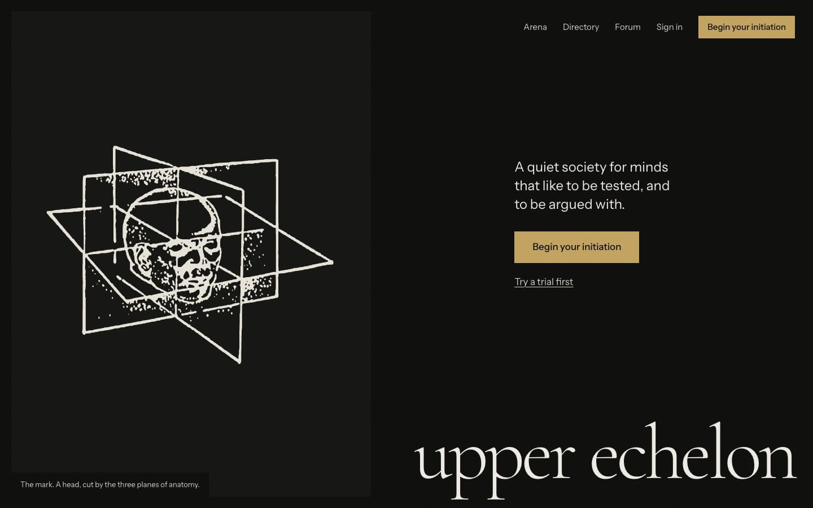

| | |
|---|---|
| 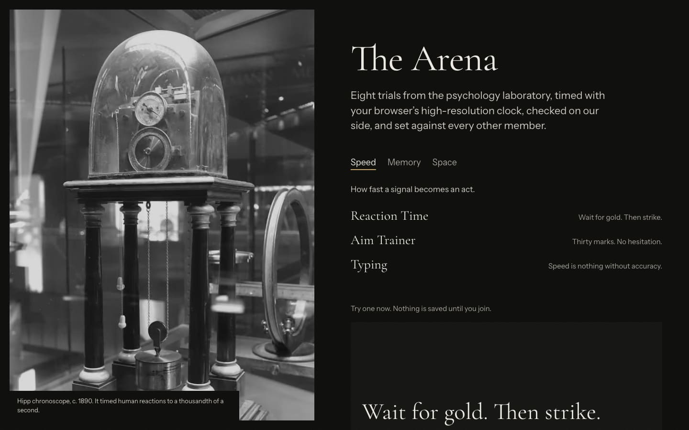 | 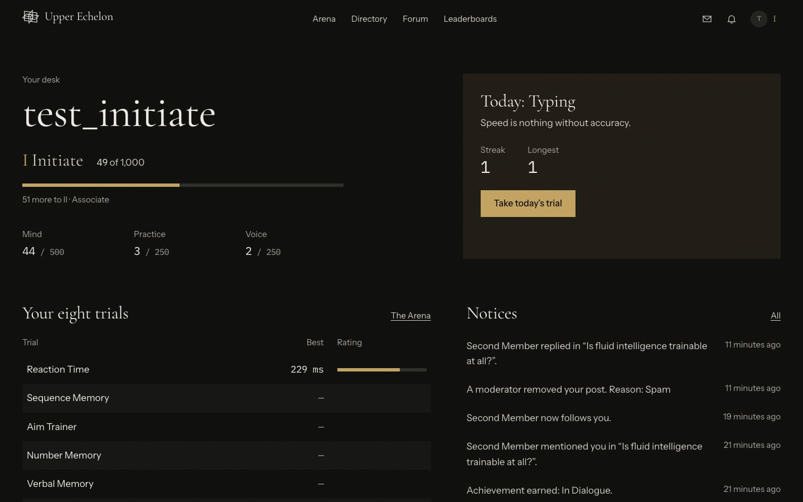 |
|  | 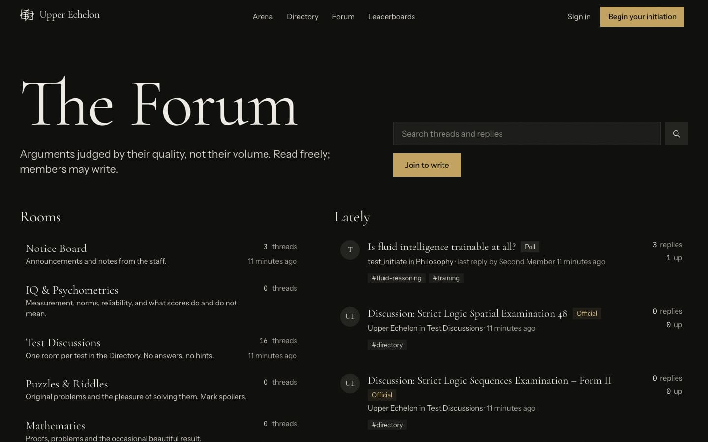 |
| 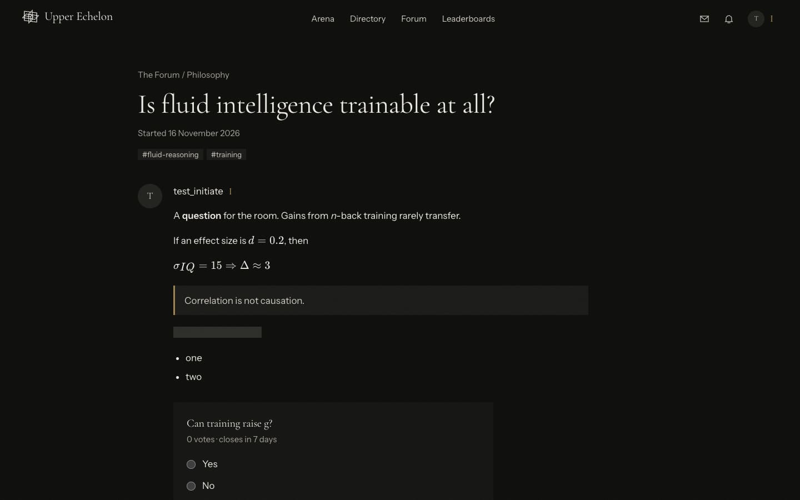 | 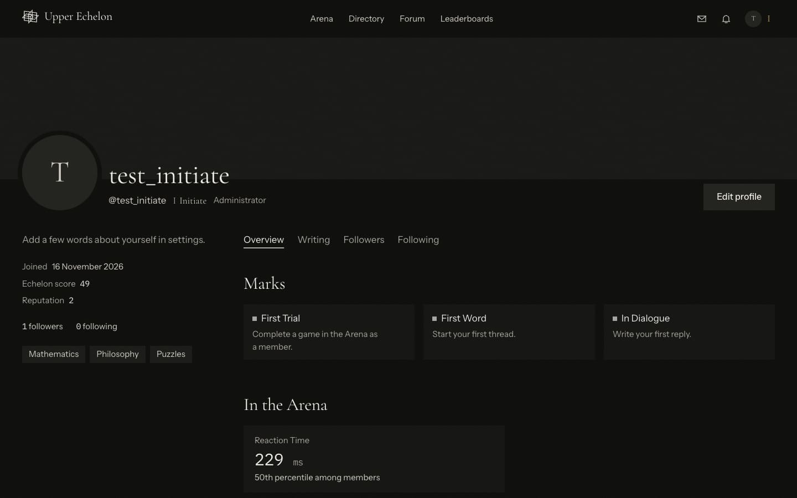 |
| 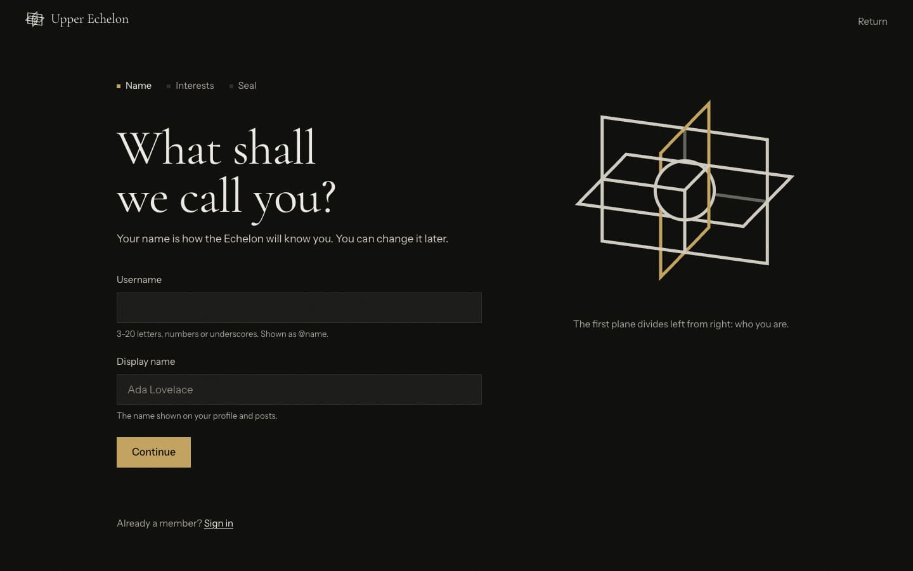 | 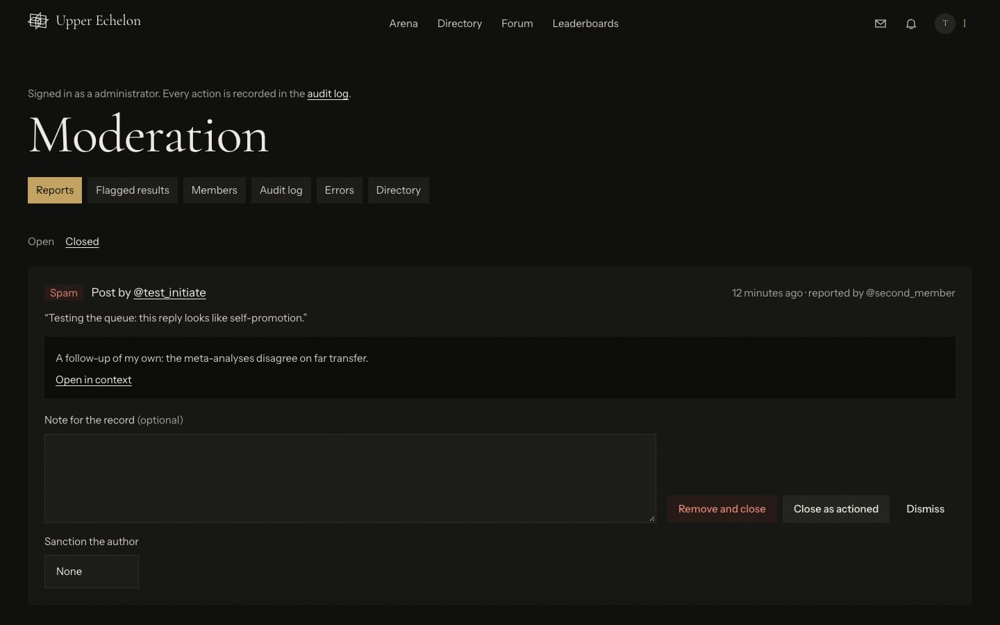 |

<p>
  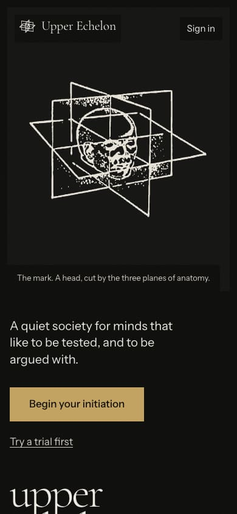
  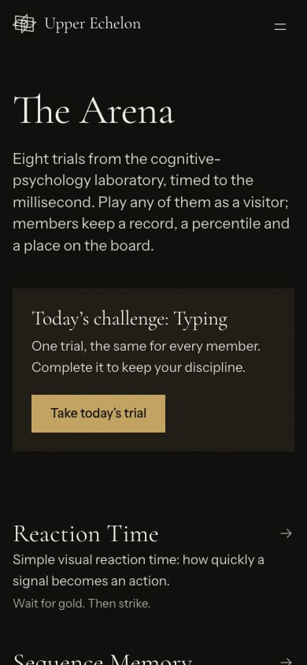
  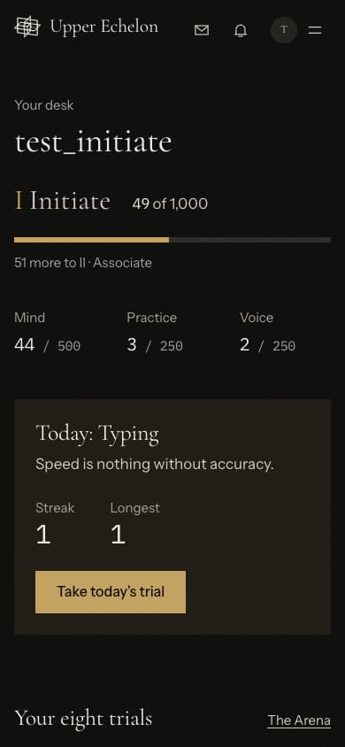
  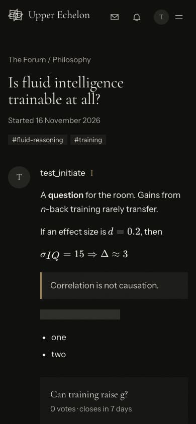
</p>

## What's inside

- **The Arena**: Reaction Time, Sequence Memory, Aim Trainer, Number Memory, Verbal Memory, Chimp
  Test, Visual Memory and Typing. Each runs on mouse, touch or keyboard and is timed with
  `performance.now()`. Members get history charts, personal bests, a percentile against all members,
  and global, weekly, daily and per-tier leaderboards. Results are recomputed and checked on the server
  (anti-cheat), and a daily challenge keeps streaks.
- **The Directory**: 16 tests, from Mensa Norway to the high-range tests by other authors (Neurolus,
  NUMERUS, LDA-SWaN, THETIS, Jonathan Wai's SLSE forms and more). Facts come from each official page,
  and the site hosts no questions. Members log results with an optional screenshot as proof, marked
  self-reported and hideable. Each test has a discussion room, and admins can add, edit and remove
  entries.
- **The Forum**: 12 rooms including the tier-locked Inner Room. Markdown with KaTeX, images, quotes,
  code, polls, @mentions and ||spoilers||. Also drafts, edit history, upvotes and reputation, bookmarks,
  followed threads, tags, sorting by new, top or active, full-text search, live replies, pinned and
  locked threads, and accepted answers.
- **Ranks**: six tiers from Initiate to Laureate driven by a documented 0–1,000 score, plus 17 marks,
  tier-unlocked profile themes and the Inner Room.
- **Members**: the Initiation (a short joining sequence), email, password, magic link, Google, 2FA and
  password reset, all with a minimum age of 13. Profiles have a cropped avatar and banner, links,
  pronouns, a showcase, an activity feed and followers. Privacy is set per item, alongside follow,
  block and mute.
- **Messages and notices**: private conversations with privacy rules, realtime delivery, block, report
  and delete. A notification centre plus optional emails, configurable per kind.
- **Safety**: reports on everything, a moderator queue with snapshots, removal and restore, warnings,
  mutes, temporary and permanent bans, review of flagged results, an audit log and an admin role
  manager. Rate limits live in the database, Turnstile guards sign-up, and uploaded images are stripped
  of metadata.
- **Your data**: a one-click JSON export and real account deletion.
- **Quality**: designed loading, empty, error, offline, rate-limited and banned states. Responsive from
  360 px, installable as a PWA, AA contrast, reduced motion respected, sitemap, and per-thread and
  per-member share images.

## Architecture

Next.js 16 (App Router, TypeScript) on Vercel, with Supabase for Postgres, Auth, Storage and Realtime,
and row-level security on every table. Server Actions handle mutations. Database triggers and
`SECURITY DEFINER` functions own every derived fact (scores, tiers, reputation, notifications). Game
results and images are written by the server only, after validation. Full details:
[docs/architecture.md](docs/architecture.md).

```
Browser ──(Server Components, Server Actions)──► Next.js on Vercel ──(user session, RLS)──► Supabase Postgres
   │                                                   │  service role: game results, uploads,
   └──── Supabase Realtime (replies, DMs, notices) ◄───┘  deletion, cron, email outbox
```

## Scoring and tiers

```
Mind     = round( 5 × mean of best ratings across the 8 trials )   0–500   (unplayed = 0)
Practice = round( 2.5 × days with a saved result, up to 100 )      0–250
Voice    = min( reputation, 250 )                                   0–250   (2 per upvote, 15 per accepted answer)
Echelon score = Mind + Practice + Voice                             0–1000
```

| Tier | I Initiate | II Associate | III Fellow | IV Savant | V Luminary | VI Laureate |
|---|---|---|---|---|---|---|
| From | 0 | 100 | 250 | 450 | 650 | 850 |

Tiers are kept once reached. Rating anchors per trial, percentiles, achievements and the anti-cheat
rules are in [docs/scoring.md](docs/scoring.md).

## Run it locally

```bash
npm install
npx supabase start          # needs Docker
cp .env.example .env.local  # paste the keys printed by the previous command
npm run seed:staff
npm run dev                 # http://localhost:3000 · emails at http://127.0.0.1:54324
```

Checks: `npm run lint`, `npm run typecheck`, `npm test`, `npm run test:integration`, `npm run build`.
Deployment, environment variables and the free-tier analysis: [docs/setup.md](docs/setup.md).
Backups: [docs/backups.md](docs/backups.md). Brand system: [docs/brand.md](docs/brand.md).

## Notes

- The legal pages (privacy, terms, cookies, guidelines) are **drafts for review**.
- The only seeded content is the official staff account's clearly labelled welcome threads and one
  discussion room per Directory test. There are no fake members, posts or statistics.
- Archive photographs are credited in `brand/archive/credits.json` and on the landing page.
